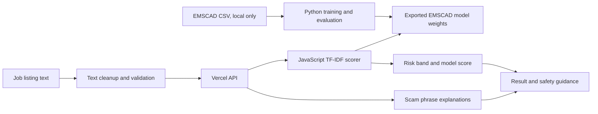

# 🛡️ JobShield: Fake Job Detection

JobShield is a web app that analyzes job listings for common scam signals. Its live JavaScript classifier is trained on the real EMSCAD fake job postings dataset and shows held-out evaluation metrics, matched warning phrases, and practical verification steps.

🔗 **Live demo:** [jobshield-fake-job-detection.vercel.app](https://jobshield-fake-job-detection.vercel.app/) · **Repository:** [simoneanand0-web/jobshield-fake-job-detection](https://github.com/simoneanand0-web/jobshield-fake-job-detection)

*Illustrative interface preview. The model metrics below come from an actual held-out split of EMSCAD, not this preview.*

## Why JobShield?

Fraudulent job ads can be used to request fees, collect sensitive information, or involve applicants in payment and reshipping schemes. JobShield checks listing text for known warning patterns and explains what it matched. It is a screening aid, not proof that a listing or employer is genuine.

## Features

- Analyze pasted listings up to 12,000 characters.
- Show Low, Medium, or High risk and a sigmoid-calibrated model score that is not presented as a verified real-world probability.
- Highlight matching phrases for upfront fees, messaging-app contact, personal email services, sensitive information requests, unrealistic pay, and payment or reshipping schemes.
- Compare Naive Bayes, Logistic Regression, calibrated Linear SVM, and a soft-voting ensemble.
- Display fake-class precision, recall, F1, PR-AUC, and confusion matrices from a held-out test split.
- View the dataset source, class balance, model version, update date, evaluation method, and limitations in **About this model**.
- Sign in or register with Clerk; save recent check summaries in the current browser.
- Import text from some public job pages. Pasting the description is the fallback when a site blocks import.
- Keep the listing text out of browser history; the API receives it only to analyze the current request.

## How it works

The training script joins `title`, `company_profile`, `description`, `requirements`, and `benefits`; strips HTML; normalizes whitespace; filters very short text; and removes duplicate combined listings **before** splitting. It creates a stratified 80/20 train/test split with seed 42. A separate validation split inside the training portion selects the live classifier by fake-class F1, then PR-AUC. The test split is not used to choose that classifier.

The candidates are Multinomial Naive Bayes, Logistic Regression with balanced class weights, sigmoid-calibrated Linear SVM with balanced class weights, and a soft-voting ensemble that averages the three model scores. The selected SVM and its TF-IDF vocabulary, IDF values, and coefficients are exported to `api/model_weights.json`. `api/model.js` reproduces the scikit-learn tokenization, stop-word filtering, TF-IDF weighting, normalization, and inference in JavaScript. A parity test checks the JavaScript scores against Python outputs.

## Dataset

JobShield uses the **Employment Scam Aegean Dataset (EMSCAD)**, distributed on [Kaggle](https://www.kaggle.com/datasets/shivamb/real-or-fake-fake-jobposting-prediction). The Kaggle dataset page labels its release **CC0: Public Domain**. The CSV used to train this version came from a [CC0-labeled Hugging Face mirror](https://huggingface.co/datasets/victor/real-or-fake-fake-jobposting-prediction) of the Kaggle dataset. The original EMSCAD paper describes 17,880 job ads posted between 2012 and 2014: 17,014 legitimate and 866 fraudulent. See Vidros et al., [“Automatic Detection of Online Recruitment Frauds: Characteristics, Methods, and a Public Dataset”](https://doi.org/10.3390/fi9010006).

The raw Kaggle CSV is not included in this repository. After combining the five text fields, removing entries shorter than 36 characters, excluding conflicting duplicate labels (none in this copy), and removing case-insensitive duplicate text, **15,870** unique listings remain: **15,159 legitimate** and **711 fake**. The live model uses only listing text; it does not inspect employer domains or verify a live job page.

The dataset is provided for model development and evaluation. Its labels and licensing are inherited from the dataset release; cite both the Kaggle page and the original EMSCAD paper when reusing the data or model.

## Model performance

The following results are from the stratified 20% test partition (**3,174 listings**, including **142 fake** and **3,032 legitimate**). Each reported metric is calculated for the fake-job positive class, except accuracy. PR-AUC is average precision, which summarizes precision and recall across score thresholds. Accuracy is included as a secondary measure because the dataset is imbalanced.

| Classifier | Fake precision | Fake recall | Fake F1 | PR-AUC | Accuracy |
| --- | ---: | ---: | ---: | ---: | ---: |
| **Calibrated Linear SVM (live)** | **84.8%** | **74.6%** | **79.4%** | **85.2%** | 98.3% |
| Soft Voting Ensemble | 90.6% | 67.6% | 77.4% | 82.8% | 98.2% |
| Logistic Regression | 62.9% | 82.4% | 71.3% | 82.6% | 97.0% |
| Multinomial Naive Bayes | 65.4% | 23.9% | 35.1% | 39.8% | 96.0% |

The live classifier was selected using a stratified validation split from the training data (seed 43), ranked by fake-class F1 and then PR-AUC. The table reports all four candidates on the separate test split at a 0.5 decision threshold. No threshold tuning was performed on the test data.

### Live model confusion matrix

Rows are actual labels; columns are predicted labels. The fake listing is the positive class.

| Actual class | Predicted legitimate | Predicted fake |
| --- | ---: | ---: |
| Legitimate | TN: 3,013 | FP: 19 |
| Fake | FN: 36 | TP: 106 |

The 98.3% accuracy should not be read as “98.3% of scams caught.” On this test split the selected model caught 106 of 142 fake listings (74.6% recall); it missed 36. The SVM uses sigmoid calibration, but its score has not been validated as a real-world probability on newer listings.

## Example checks

These are illustrative examples, not part of the EMSCAD test metrics.

**Fake-style text:** “No experience needed; earn $5,000 weekly. Contact us only on WhatsApp, email recruiter@gmail.com, and pay a registration fee to secure your position.”

The live model returns **High risk (76/100)** and highlights the upfront fee, unusually high pay with few requirements, WhatsApp-led contact, and personal email. The score is a screening signal, not proof.

**Legitimate-style text:** “Data analyst position. Use SQL and Python to build dashboards for the product team. Salary range is $70,000 to $90,000. Health insurance, paid leave, equal opportunity employer. Apply through the official company careers page.”

The live model returns **Low risk (3/100)**. That result does not verify the employer or guarantee that a listing is safe.

## Engineering and tests

- **Frontend:** HTML, CSS, and browser JavaScript.
- **API and live inference:** Vercel Node.js Functions.
- **Training and evaluation:** Python, pandas, scikit-learn, and joblib.
- **Authentication:** Clerk.
- **Hosting and source control:** Vercel and GitHub.
- **Tests:** Node's built-in test runner checks input validation, explanation rules, model metadata, all 40 original hand-written examples as qualitative checks, and JavaScript/Python scoring parity on exported examples.

The hand-written examples are preserved in `tests/qualitative-listings.json`. They are not part of training or the performance metrics. Qualitative checks are useful for trying newer wording, but 40 examples are too small to establish real-world accuracy.

## Run locally

### Start the app

Requirements: Node.js 20.9+, Python 3.10+ for model training, and a Clerk application with email sign-in enabled.

~~~powershell
git clone https://github.com/simoneanand0-web/jobshield-fake-job-detection.git
Set-Location jobshield-fake-job-detection
npm install
Copy-Item .env.example .env.local
~~~

Put your own Clerk keys in `.env.local`. Keep the secret key private and never commit `.env.local`.

~~~dotenv
CLERK_SECRET_KEY=sk_test_replace_with_your_clerk_secret_key
NEXT_PUBLIC_CLERK_PUBLISHABLE_KEY=pk_test_replace_with_your_clerk_publishable_key
~~~

Link the Vercel project and run the site:

~~~powershell
npm install --global vercel
vercel login
vercel link
npm run dev
~~~

Run the app tests:

~~~powershell
npm test
~~~

### Retrain the model

Download `fake_job_postings.csv` from the [Kaggle dataset page](https://www.kaggle.com/datasets/shivamb/real-or-fake-fake-jobposting-prediction) and place it at `data/fake_job_postings.csv`. The `data/` directory is ignored by Git.

~~~powershell
python -m venv .venv
.\.venv\Scripts\Activate.ps1
python -m pip install -r requirements.txt
python train_models.py --data data\fake_job_postings.csv
npm test
~~~

Training writes the deployable JavaScript weights to `api/model_weights.json`, the cross-language parity fixture to `tests/model-parity.json`, and the confusion matrix image to `docs/figures/holdout-confusion-matrix.svg`. The raw dataset and `model_artifacts/` are not committed. Review the generated metrics before publishing the updated weights.

## Limitations

- EMSCAD contains English-language posts from 2012–2014. Scam tactics, hiring platforms, and regional wording change; newer WhatsApp/Telegram-led scams may be missed.
- The test set is a random split from the same dataset, not a test on recent postings or a different job platform.
- Text-only features do not verify a company, recruiter email, domain, or job URL. Web page import is not employer verification.
- The selected SVM's score is sigmoid-calibrated on the training data, but calibration has not been validated on recent listings; it is not a trustworthy real-world fraud probability.
- Phrase matches can miss context or flag harmless text. A personal email address, messaging app, or high salary alone does not prove fraud.
- The dataset may contain duplicate, incomplete, or incorrectly labeled entries. Duplicate text was removed before the split, but the test results still reflect this dataset's limits.
- Always find the employer's official website independently and verify the role and recruiter before sharing money or sensitive details.

## Model version, author, and code license

- **Live model version:** 3.0.0
- **Model update date:** 2026-11-21
- **Author:** [simoneanand0-web](https://github.com/simoneanand0-web)
- **Dataset:** EMSCAD, distributed via Kaggle under the CC0 label shown on its dataset page; original research citation linked above.
- **Code license:** No code license file is included. Ask the repository owner before reusing or redistributing this project code.
