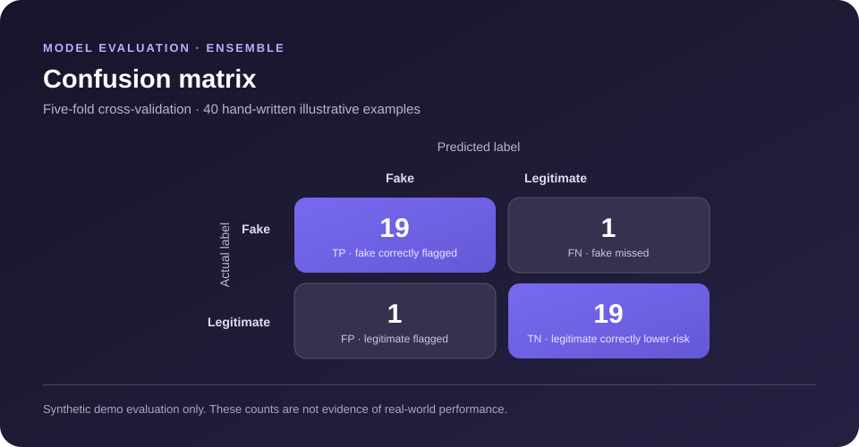

# 🛡️ JobShield: Fake Job Detection

An ML-powered web app that reviews job listings for common scam signals and highlights the phrases behind its result.

🔗 **Live demo:** [jobshield-fake-job-detection.vercel.app](https://jobshield-fake-job-detection.vercel.app/) · **Repository:** [GitHub](https://github.com/simoneanand0-web/jobshield-fake-job-detection)

*Sample result preview generated from the bundled classifier. It is an illustrative visual, not a browser recording.*

## Why JobShield?

Online job scams can ask applicants to pay fees, share financial or identity details, or move money or packages. JobShield checks listing text for these patterns, explains what it matched, and suggests ways to verify the employer. It is a second opinion, not proof that a listing is fake or safe.

## Features

- Analyze pasted job descriptions between 35 and 12,000 characters.
- Show a Low, Medium, or High risk label, demo risk score, and separate uncalibrated model-agreement value.
- Highlight matched phrases for upfront fees, WhatsApp or Telegram contact, personal email providers, unusually high pay paired with few requirements, sensitive information requests, and other signals.
- Try a sample listing without preparing your own text.
- Sign in or register using Clerk.
- Import text from eligible public HTTPS listing pages.
- Save recent check summaries and feedback in the current browser; full listing text is not saved in browser history.
- Compare classifier metrics in the app's About this model panel.
- Run an optional Python classifier comparison on a CSV dataset you provide.

## How it works

1. The user pastes a listing or imports text from an eligible public page.
2. The API validates the text (minimum 35, maximum 12,000 characters), lowercases it, tokenizes letters and digits, and removes one-character tokens and a small stop-word list.
3. The live JavaScript model averages outputs from Multinomial Naive Bayes, Logistic Regression, and Linear SVM.
4. Separate phrase-matching rules find warning and positive details for the explanation panel. The app shows the risk label, demo score, matched phrases, and advice.
5. The browser can save a short summary to local history; it does not save the listing text there.

The live classifier uses cleaned word tokens. The optional Python experiment uses scikit-learn TF-IDF pipelines; those Python models are not used by the live Vercel API. Model agreement describes how close the three live model outputs are. It is not a calibrated confidence score, and the demo risk score is not a probability.

## Model performance

### Dataset and evaluation

- **Dataset:** JobShield illustrative demo corpus bundled in api/model.js.
- **Size and class balance:** 40 hand-written examples: 20 legitimate-style and 20 fake-style listings (50% each).
- **Source:** Synthetic examples written for this demo. The live model does not use EMSCAD or another external dataset.
- **Evaluation:** Deterministic, class-balanced five-fold cross-validation over the 40 examples; each example is evaluated once.
- **Imbalance handling:** The live demo corpus is balanced, so the live classifier uses no class weights or resampling. The optional Python script uses a stratified holdout split and balanced class weights for Logistic Regression, Linear SVM, and Random Forest.

### Cross-validation results

| Classifier | Accuracy | Precision | Recall | F1-score |
| --- | ---: | ---: | ---: | ---: |
| Naive Bayes | 93% | 87% | 100% | 93% |
| Logistic Regression | 95% | 100% | 90% | 95% |
| Linear SVM | 95% | 100% | 90% | 95% |
| Ensemble | 95% | 95% | 95% | 95% |

### Ensemble confusion matrix

Positive class: fake listing. Rows are actual labels and columns are predicted labels.

| Actual class | Predicted fake | Predicted legitimate |
| --- | ---: | ---: |
| Fake | TP: 19 | FN: 1 |
| Legitimate | FP: 1 | TN: 19 |

**How to read the 95% accuracy:** the ensemble classified 38 of these 40 illustrative examples correctly. This result describes only the small synthetic demo corpus; it is not validated performance on real or newer scam listings.

## Example checks

**Fake-style sample**

~~~text
No experience needed; earn $5,000 weekly. Contact us only on WhatsApp, email recruiter@gmail.com and pay a registration fee to secure your position.
~~~

Model version 2.1.0 returns **High risk**, a **96/100 demo risk score**, and **88% model agreement (uncalibrated)**. It highlights the upfront payment, high pay with few requirements, WhatsApp-led contact, and personal email address.

**Legitimate-style sample**

~~~text
Data analyst position. Use SQL and Python to build dashboards for the product team. Salary range is $70,000 to $90,000. Health insurance, paid leave, equal opportunity employer. Apply through the official company careers page.
~~~

Model version 2.1.0 returns **Low risk**, a **6/100 demo risk score**, and **84% model agreement (uncalibrated)**. Low risk does not mean the employer or role has been verified.

## Tech stack

- **Frontend:** HTML, CSS, and browser JavaScript.
- **Backend/API:** Vercel Node.js Functions.
- **Live ML:** JavaScript Naive Bayes, Logistic Regression, and Linear SVM ensemble.
- **Optional model experiments:** Python, pandas, scikit-learn, and joblib.
- **Authentication:** Clerk.
- **Hosting:** Vercel.
- **Source control:** GitHub.

## Run locally

### Requirements

- Node.js 20.9 or newer.
- A Clerk application with email sign-in enabled.
- Vercel CLI.
- Python and packages in requirements.txt only for the optional CSV experiment.

### Start the web app

~~~powershell
git clone https://github.com/simoneanand0-web/jobshield-fake-job-detection.git
Set-Location jobshield-fake-job-detection
npm install
npm install --global vercel
Copy-Item .env.example .env.local
~~~

Edit .env.local and replace the placeholder values with your Clerk **test** keys. Keep CLERK_SECRET_KEY private and do not commit .env.local.

~~~dotenv
CLERK_SECRET_KEY=sk_test_replace_with_your_clerk_secret_key
NEXT_PUBLIC_CLERK_PUBLISHABLE_KEY=pk_test_replace_with_your_clerk_publishable_key
~~~

Then link the project and start the local Vercel server:

~~~powershell
vercel login
vercel link
npm run dev
~~~

Open the local URL printed by Vercel. Run the model and input-validation unit tests with:

~~~powershell
node --test
~~~

### Optional Python experiment

Prepare a CSV with text and fraudulent columns. Use 0 for legitimate and 1 for fraudulent, with at least two examples in each class.

~~~powershell
python -m pip install -r requirements.txt
python train_models.py --data path\to\job_posts.csv --output model_artifacts
~~~

This separate script prints holdout metrics and writes the best-by-F1 model and comparison JSON to model_artifacts/. Its trained artifacts do not update the live Vercel model.

## Limitations

- The live classifier uses only 40 hand-written examples and is not trained on EMSCAD or a current external dataset.
- New scam wording, languages, regions, and job markets may differ from the demo examples.
- The demo risk score and model-agreement value are uncalibrated screening estimates.
- Phrase matches can miss context or flag legitimate details. A personal email address, high pay, or messaging app alone does not prove fraud.
- Page import may fail when a listing is private, requires sign-in, or blocks extraction; pasting the description is the fallback.
- Listing text is sent to the API for analysis. Browser history stores only summaries, not the full description.
- Always verify the company, recruiter, and role through contact details found independently on the employer's official website.

## Future work

- Evaluate on a larger, licensed, current dataset with its real class balance.
- Add a held-out external benchmark, threshold tuning, and broader tests.
- Improve employer-domain and recruiter verification without treating any single signal as proof.
- Study regional scam patterns and multilingual listings.
- Add a user-submitted scam-report workflow with appropriate review and privacy controls.

## Version, author, and license

- **Live model version:** 2.1.0
- **Last model update:** 2026-11-21
- **GitHub:** [simoneanand0-web](https://github.com/simoneanand0-web)
- **License:** No license file is included; ask the repository owner before reusing or redistributing the code.
