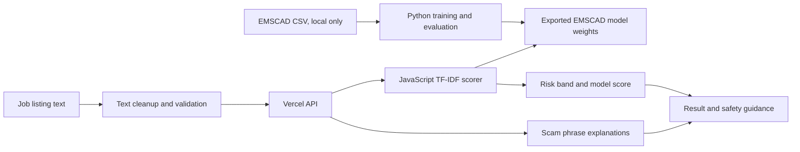
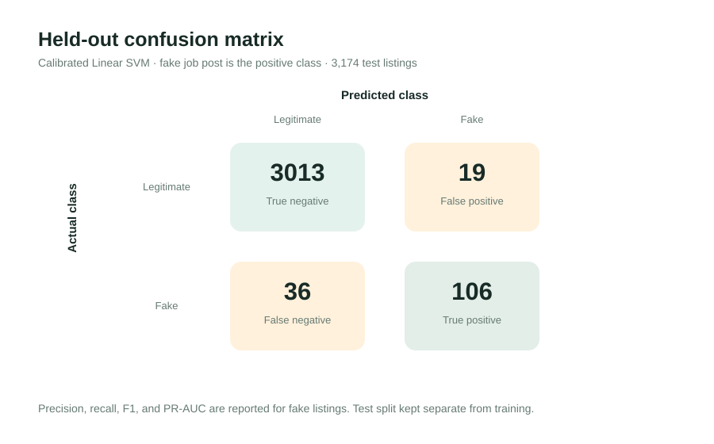

# 🛡️ JobShield: Fake Job Detection

JobShield is a web app that analyzes job listings for common scam signals. Its live JavaScript classifier is trained on the real EMSCAD fake job postings dataset and shows held-out evaluation metrics, matched warning phrases, and practical verification steps.

🔗 **Live demo:** [jobshield-fake-job-detection.vercel.app](https://jobshield-fake-job-detection.vercel.app/) · **Repository:** [simoneanand0-web/jobshield-fake-job-detection](https://github.com/simoneanand0-web/jobshield-fake-job-detection)

**Live model:** v3.0.0 · **Classifier:** Calibrated Linear SVM

*Illustrative interface preview. The model metrics below come from an actual held-out split of EMSCAD, not this preview.*

## Why JobShield?

Fraudulent job ads can be used to request fees, collect sensitive information, or involve applicants in payment and reshipping schemes. JobShield checks listing text for known warning patterns and explains what it matched. It is a screening aid, not proof that a listing or employer is genuine.

## Features

- Analyze pasted listings up to 12,000 characters.
- Show Low, Medium, or High risk and a sigmoid-calibrated model score that is not presented as a verified real-world probability.
- Highlight matching phrases for upfront fees, messaging-app contact, personal email services, sensitive information requests, unrealistic pay, and payment or reshipping schemes.
- Compare Naive Bayes, Logistic Regression, calibrated Linear SVM, and a soft-voting ensemble.
- Display held-out fake-class metrics and confusion matrices, 5-fold CV mean and spread, and a recall-vs-false-alarm cutoff comparison.
- View the dataset source, class balance, model version, update date, evaluation method, and limitations in **About this model**.
- Sign in or register with Clerk; save recent check summaries in the current browser.
- Import text from some public job pages. Pasting the description is the fallback when a site blocks import.
- Keep the listing text out of browser history; the API receives it only to analyze the current request.

## How it works

The training script joins `title`, `company_profile`, `description`, `requirements`, and `benefits`; strips HTML; normalizes whitespace; filters very short text; and removes duplicate combined listings **before** splitting. It creates a stratified 80/20 train/test split with seed 42. A separate validation split inside the training portion selects the live classifier by fake-class F1, then PR-AUC. The test split is not used to choose that classifier.

The candidates are Multinomial Naive Bayes, Logistic Regression with balanced class weights, sigmoid-calibrated Linear SVM with balanced class weights, and a soft-voting ensemble that averages the three model scores. The selected SVM and its TF-IDF vocabulary, IDF values, and coefficients are exported to `api/model_weights.json`. `api/model.js` reproduces the scikit-learn tokenization, stop-word filtering, TF-IDF weighting, normalization, and inference in JavaScript. A parity test checks the JavaScript scores against Python outputs.

## Dataset

JobShield uses the **Employment Scam Aegean Dataset (EMSCAD)**, distributed on [Kaggle](https://www.kaggle.com/datasets/shivamb/real-or-fake-fake-jobposting-prediction). The Kaggle dataset page labels its release **CC0: Public Domain**. The CSV used to train this version came from a [CC0-labeled Hugging Face mirror](https://huggingface.co/datasets/victor/real-or-fake-fake-jobposting-prediction) of the Kaggle dataset. The original EMSCAD paper describes 17,880 job ads posted between 2012 and 2014: 17,014 legitimate and 866 fraudulent. See Vidros et al., [“Automatic Detection of Online Recruitment Frauds: Characteristics, Methods, and a Public Dataset”](https://doi.org/10.3390/fi9010006).

The raw Kaggle CSV is not included in this repository. After combining `title`, `company_profile`, `description`, `requirements`, and `benefits`, removing entries shorter than 36 characters, excluding conflicting duplicate labels (none in this copy), and removing case-insensitive duplicate text **before splitting**, **15,870** unique listings remain: **15,159 legitimate** and **711 fake**. A stratified 80/20 split with seed 42 gives 12,696 training listings and 3,174 held-out test listings. Logistic Regression and Linear SVM use `class_weight="balanced"` to account for the roughly 4.5% fake class. The live model uses only listing text; it does not inspect employer domains or verify a live job page.

The dataset is provided for model development and evaluation. Its labels and licensing are inherited from the dataset release; cite both the Kaggle page and the original EMSCAD paper when reusing the data or model.

## Model performance

The following results are from the stratified 20% test partition (**3,174 listings**, including **142 fake** and **3,032 legitimate**). Each reported metric is calculated for the fake-job positive class, except accuracy. PR-AUC is average precision, which summarizes precision and recall across score thresholds. Accuracy is included as a secondary measure because the dataset is imbalanced.

| Classifier | Fake precision | Fake recall | Fake F1 | PR-AUC | Accuracy |
| --- | ---: | ---: | ---: | ---: | ---: |
| **Calibrated Linear SVM (live)** | **84.8%** | **74.6%** | **79.4%** | **85.2%** | 98.3% |
| Soft Voting Ensemble | 90.6% | 67.6% | 77.4% | 82.8% | 98.2% |
| Logistic Regression | 62.9% | 82.4% | 71.3% | 82.6% | 97.0% |
| Multinomial Naive Bayes | 65.4% | 23.9% | 35.1% | 39.8% | 96.0% |

The live model is **v3.0.0**, a **Calibrated Linear SVM**. It was selected using a stratified validation split from the training data (seed 43), ranked by fake-class F1 and then PR-AUC. The table reports all four candidates on the separate test split at the 0.5 decision threshold. No threshold tuning was performed on the test data.

The live model's **98.3% accuracy** is above the **95.5% majority-class baseline**: predicting every listing as legitimate would score 3,032/3,174 correct, while catching **zero** fake posts. That is why fake-class precision, recall, F1, and PR-AUC are more informative here than accuracy alone.

### Held-out confusion matrices

TP = fake listings correctly flagged; FP = legitimate listings incorrectly flagged; FN = fake listings missed; TN = legitimate listings correctly left unflagged. All counts use the same 3,174 held-out listings and 0.5 cutoff.

| Classifier | TP | FP | FN | TN |
| --- | ---: | ---: | ---: | ---: |
| **Calibrated Linear SVM (live)** | **106** | **19** | **36** | **3,013** |
| Soft Voting Ensemble | 96 | 10 | 46 | 3,022 |
| Logistic Regression | 117 | 69 | 25 | 2,963 |
| Multinomial Naive Bayes | 34 | 18 | 108 | 3,014 |

The SVG below visualizes the live model's matrix. Rows are actual labels; columns are predicted labels. The fake listing is the positive class.

The 98.3% accuracy should not be read as “98.3% of scams caught.” On this test split the selected model caught 106 of 142 fake listings (74.6% recall); it missed 36. The SVM uses sigmoid calibration, but its score has not been validated as a real-world probability on newer listings.

### 5-fold stratified cross-validation

To check fold-to-fold stability, the selected Calibrated Linear SVM was evaluated at the same 0.5 cutoff in five stratified folds within the 80% training partition. Each fold fits its own TF-IDF vocabulary and calibrator. Values are the mean and sample standard deviation (in percentage points) across the five folds. The final 20% test split was excluded from this cross-validation.

| Metric | 5-fold mean ± SD |
| --- | ---: |
| Fake precision | 88.22% ± 2.56 pp |
| Fake recall | 75.22% ± 4.27 pp |
| Fake F1 | 81.08% ± 2.07 pp |
| PR-AUC | 86.40% ± 2.97 pp |
| Accuracy | 98.42% ± 0.18 pp |

This is a stability estimate from the same historical source, not independent evidence of performance on current postings.

### Decision threshold trade-off

The deployed cutoff remains **0.50**. On the training validation split only, a candidate cutoff of **0.1676** was the highest cutoff that met a target of at least 85% fake-class recall (validation recall: 85.1%). Applying this frozen candidate to the held-out test split shows the trade-off:

| SVM cutoff | Fake precision | Fake recall | Fake F1 | False alarms (FP) | Missed fake posts (FN) |
| ---: | ---: | ---: | ---: | ---: | ---: |
| **0.500 live** | **84.8%** | **74.6%** | **79.4%** | **19** | **36** |
| 0.168 candidate | 69.0% | 83.1% | 75.4% | 53 | 24 |

At the candidate cutoff, the test split contains 12 more correctly flagged fake posts alongside 34 additional false alarms. The app keeps 0.50 as the live threshold for v3.0.0; **About this model** presents the alternative as a comparison, not as the current setting. A lower cutoff is not automatically better: it changes how many legitimate listings are flagged and how many scams are caught.

## Example checks

These are illustrative examples, not part of the EMSCAD test metrics.

**Fake-style text:** “No experience needed; earn $5,000 weekly. Contact us only on WhatsApp, email recruiter@gmail.com, and pay a registration fee to secure your position.”

The live model returns **High risk (76/100)** and highlights the upfront fee, unusually high pay with few requirements, WhatsApp-led contact, and personal email. The score is a screening signal, not proof.

**Legitimate-style text:** “Data analyst position. Use SQL and Python to build dashboards for the product team. Salary range is $70,000 to $90,000. Health insurance, paid leave, equal opportunity employer. Apply through the official company careers page.”

The live model returns **Low risk (3/100)**. That result does not verify the employer or guarantee that a listing is safe.

### Modern-style qualitative probes

The EMSCAD training corpus is historical, so three additional hand-written probes were run through the exported v3.0.0 model. They are **not** labeled real-world listings or a modern-scam benchmark.

| Probe | SVM score | Model output |
| --- | ---: | --- |
| WhatsApp-only interview, $5,000 weekly with no experience, registration fee, personal Gmail | 81.9/100 | Flagged |
| WhatsApp-only remote data entry, registration fee, $3,000 weekly | 89.5/100 | Flagged |
| Mumbai warehouse role asking for Aadhaar and bank details on Telegram before interview, document fee | 1/100 | **Missed by the model** |

The third probe exposes a limitation: phrase rules surface Telegram, sensitive-information, and fee warnings, but the historical-text classifier gives the listing a very low score. Two successful examples do not establish modern-market recall.

## Engineering and tests

- **Frontend:** HTML, CSS, and browser JavaScript.
- **API and live inference:** Vercel Node.js Functions.
- **Training and evaluation:** Python, pandas, scikit-learn, and joblib.
- **Authentication:** Clerk.
- **Hosting and source control:** Vercel and GitHub.
- **Tests:** Node's built-in test runner checks input validation, explanation rules, model metadata, the 40 original examples, three modern-style probes (including a known miss), and JavaScript/Python scoring parity.

The original 40 hand-written examples are preserved in `tests/qualitative-listings.json`; the three modern-style probes are in `tests/modern-scam-examples.json`. None are used for training or the EMSCAD metrics. Qualitative checks can uncover obvious misses, but they are too small and hand-authored to establish real-world accuracy.

## Run locally

### Start the app

Requirements: Node.js 20.9+, Python 3.10+ for model training, and a Clerk application with email sign-in enabled.

~~~powershell
git clone https://github.com/simoneanand0-web/jobshield-fake-job-detection.git
Set-Location jobshield-fake-job-detection
npm install
Copy-Item .env.example .env.local
~~~

Put your own Clerk keys in `.env.local`. Keep the secret key private and never commit `.env.local`.

~~~dotenv
CLERK_SECRET_KEY=sk_test_replace_with_your_clerk_secret_key
NEXT_PUBLIC_CLERK_PUBLISHABLE_KEY=pk_test_replace_with_your_clerk_publishable_key
~~~

Link the Vercel project and run the site:

~~~powershell
npm install --global vercel
vercel login
vercel link
npm run dev
~~~

Run the app tests:

~~~powershell
npm test
~~~

### Retrain the model

Download `fake_job_postings.csv` from the [Kaggle dataset page](https://www.kaggle.com/datasets/shivamb/real-or-fake-fake-jobposting-prediction) and place it at `data/fake_job_postings.csv`. The `data/` directory is ignored by Git.

~~~powershell
python -m venv .venv
.\.venv\Scripts\Activate.ps1
python -m pip install -r requirements.txt
python train_models.py --data data\fake_job_postings.csv
npm test
~~~

Training writes the deployable JavaScript weights and evaluation metadata to `api/model_weights.json`, the cross-language parity fixture to `tests/model-parity.json`, and the confusion matrix image to `docs/figures/holdout-confusion-matrix.svg`. It also prints the 5-fold results, threshold trade-off, and modern-style qualitative checks. The raw dataset and `model_artifacts/` are not committed. Review the generated metrics before publishing updated weights.

## Limitations

- EMSCAD contains English-language posts from 2012–2014. Scam tactics, hiring platforms, and regional wording change; newer WhatsApp/Telegram-led scams may be missed. The modern-style qualitative probes caught one clear miss.
- The five-fold cross-validation and held-out test split both come from EMSCAD. Neither measures current postings or a different job platform.
- At the deployed 0.5 cutoff, the held-out test split missed 36 of 142 fake posts (25.4%). The validation-selected 0.1676 candidate caught more on that test split, but raised false alarms from 19 to 53 and is not the deployed threshold.
- Text-only features do not verify a company, recruiter email, domain, or job URL. Web page import is not employer verification.
- The selected SVM's score is sigmoid-calibrated on the training data, but calibration has not been validated on recent listings; it is not a trustworthy real-world fraud probability.
- Phrase matches can miss context or flag harmless text. A personal email address, messaging app, or high salary alone does not prove fraud.
- The dataset may contain duplicate, incomplete, or incorrectly labeled entries. Duplicate text was removed before the split, but the test results still reflect this dataset's limits.
- Always find the employer's official website independently and verify the role and recruiter before sharing money or sensitive details.

## Model version, author, and code license

- **Live model version:** 3.0.0
- **Model update date:** 2026-11-21
- **Author:** [simoneanand0-web](https://github.com/simoneanand0-web)
- **Dataset:** EMSCAD, distributed via Kaggle under the CC0 label shown on its dataset page; original research citation linked above.
- **Code license:** No code license file is included. Ask the repository owner before reusing or redistributing this project code.
